# RBlog

The admin back office of a blog and its read-only Content API, for a separate Nuxt or Next site:
one Rust binary built on [RustCMS](https://irisvn.github.io/RustCMS/) v0.10.3, on MySQL 8.4 only.

<p align="center">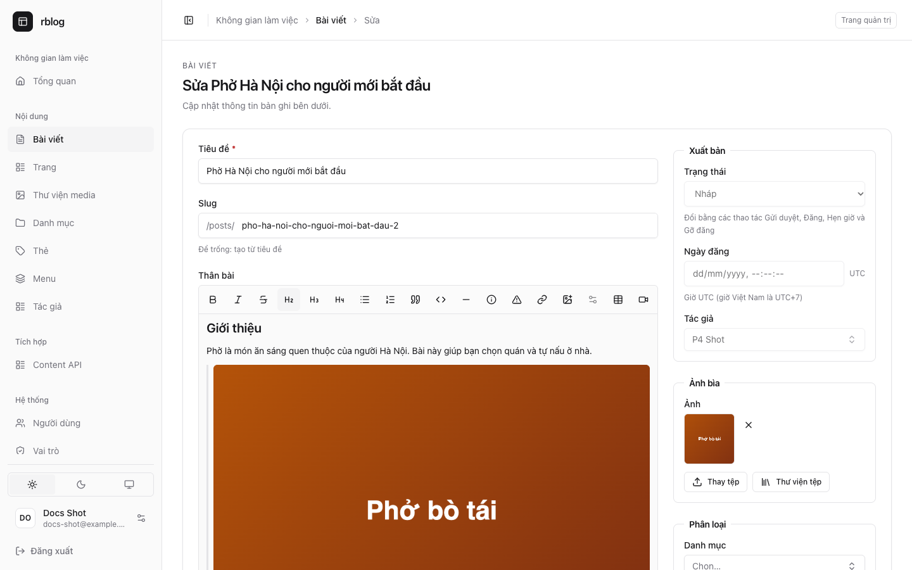</p>

## Features

- **Post and page editor**: the whole width of the window, with the slug right under the title and
  an aside (Publishing, Cover image, Organize) that stays in view. Rich text version 2: headings,
  lists, quotes, code, tables, YouTube and Vimeo embeds, info and warning callouts, images with
  captions and widths, several images uploaded at once, and a media library picker (also for
  covers and share images). SEO fields in a folded section.

  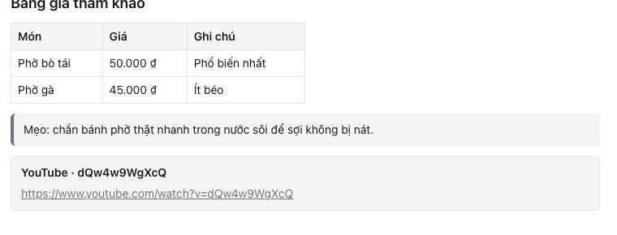

- **Posts list** with statuses (Draft, Pending review, Scheduled, Published) and row actions: each
  row offers only what applies to its status, Publish as the labelled action and Submit for
  review, Schedule…, Preview and Unpublish in its ⋯ menu. Search and filters by status,
  category, author and featured.

  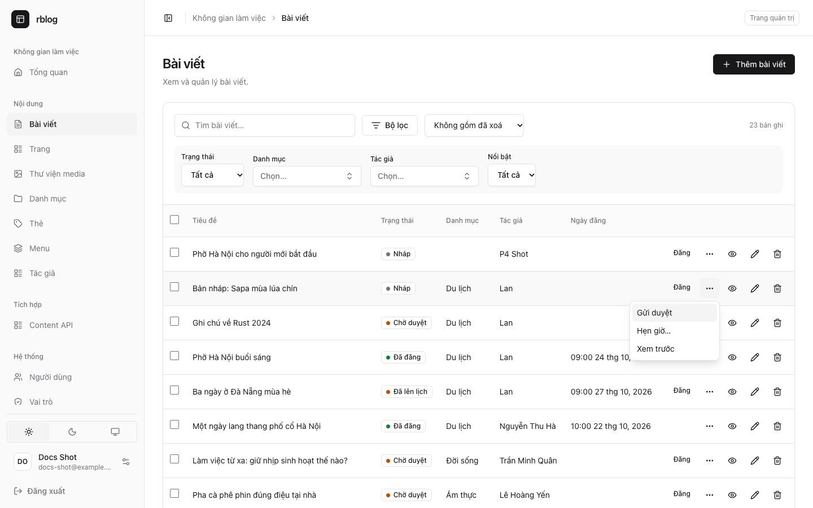

- **Scheduling and preview**: Schedule… asks for a time in UTC; scheduled posts go live every
  minute, catching up after downtime. Preview opens the public site's preview in a new tab with a
  one-hour link; the record page's preview card gives the link to copy.

  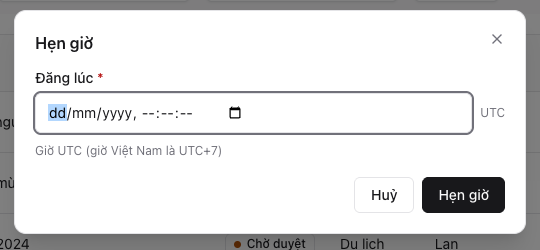

- **Revisions**: every editorial change is kept (30 per post or page); "Restore this version" on
  each row of the Revisions table puts it back.

  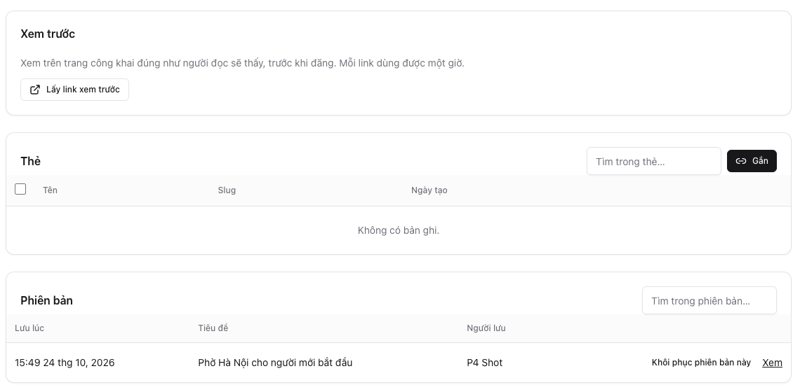

- **Roles**: Administrator, Editor, Author and Contributor, with ownership and status rules
  ([below](#roles-and-publishing)).
- **Media library** as a grid or a list, on a local disk or S3 (AWS, R2, MinIO), with alt texts
  the Content API falls back to; `media:move-disk` moves an existing site
  ([docs/media.md](docs/media.md)).

  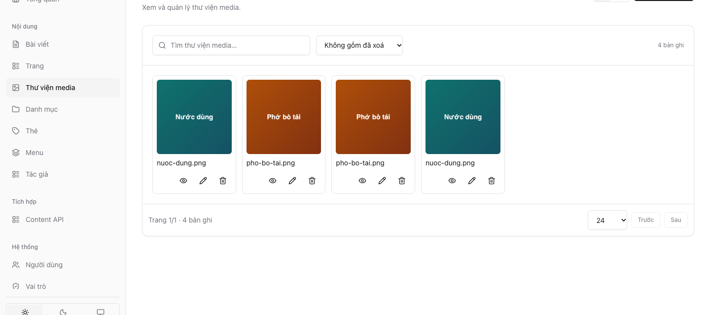

- **Settings** for the public site: General (name, language, public URL, posts per page, logo
  from the media library), Reading (homepage), SEO and social links (default share image),
  Integrations (webhook, preview path).

  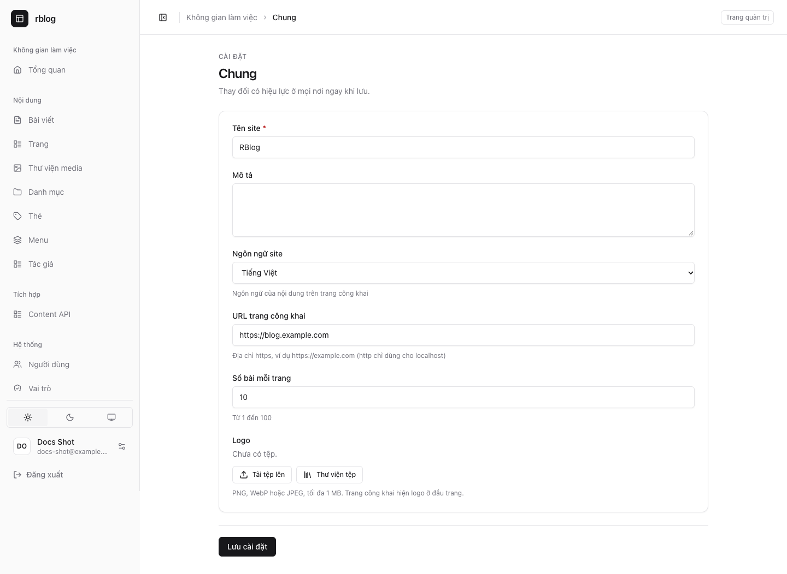

- **Menus** (`primary`, `footer`) linking posts, pages, categories, tags or URLs, and **author
  profiles** (slug, bio, website, avatar) for the public author pages.

  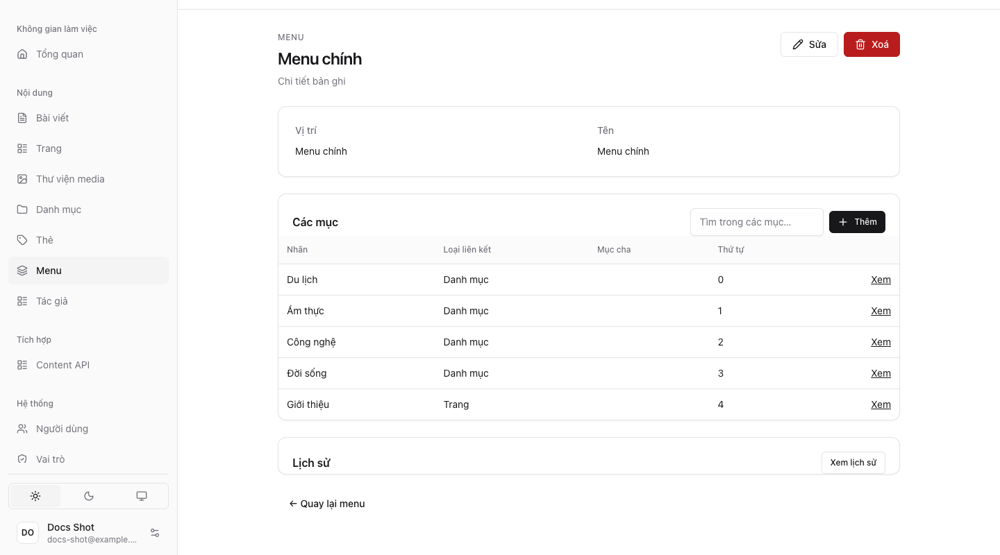

- **Dashboard**: counts of authors and of published, draft, pending and scheduled posts, posts per
  week, recently updated posts.

  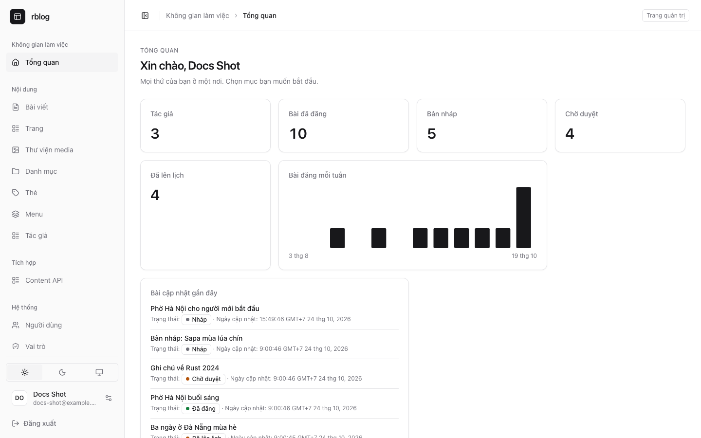

- **Content API keys** on Integrations → Content API: create a key (shown once) and revoke it.

  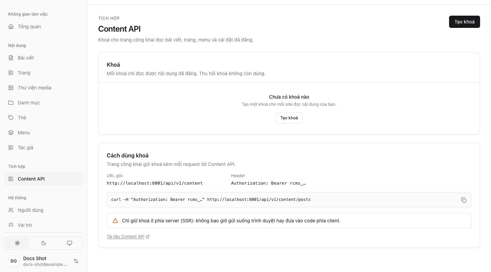

- **Vietnamese and English**, **dark mode**, and phone widths (390 px) without sideways scrolling.
  On a phone, a record's header keeps its main action and a ⋯ menu with the rest.

  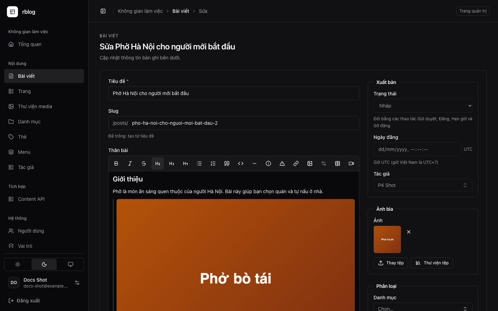 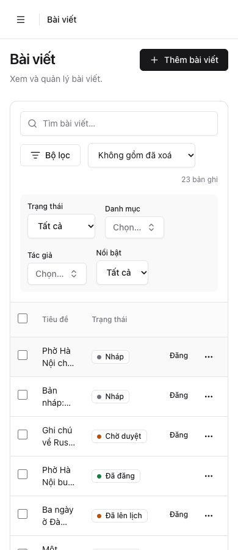 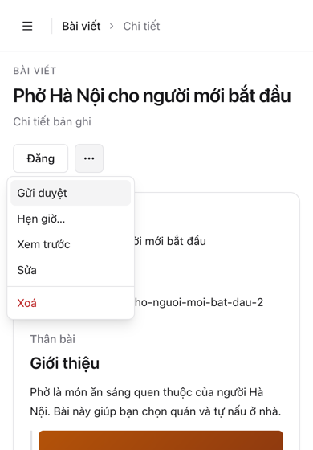

- **Webhook** to the frontend on every public change: signed (HMAC-SHA256), delivered at least
  once, with cache tags and old and new paths.

## Quick start

Needs Docker, the Rust toolchain and the `rustcms` CLI.

```sh
cp .env.example .env
rustcms key:generate                # writes APP_KEY into .env
docker compose up -d --wait         # MySQL 8.4: dev data on 3306 (database/user/password: rblog), tests on 3307 (in memory)
rustcms migrate                     # create the tables
rustcms db:seed                     # roles, and the Content API's system user
rustcms db:seed --class demo        # optional: Vietnamese demo content
rustcms make:user --email you@example.com --name "You" --super-admin   # prints a generated password
rustcms serve                       # http://localhost:8000/health
```

Then sign in at <http://localhost:8000/admin>. `rustcms <command>` runs `cargo run -- <command>`;
a built binary takes the same commands (`rblog serve`, `rblog db:seed`, …).

### Demo data

`rustcms db:seed --class demo` (`src/database/seeders/demo_seeder.rs`) is never run by
`rustcms db:seed`. It refuses when `APP_ENV=production` (even with `--force`), and running it again
adds nothing: every row is found by its email, slug, menu key or menu and label first. It creates:

- 3 authors, `thu.ha@`, `minh.quan@` and `hoang.yen@demo.rblog.local`, with author profiles. Their
  password is random and shown nowhere, and they have no role: a super admin sets a password and
  roles on the Users page to sign in as one;
- 4 categories (Du lịch, Ẩm thực, Công nghệ, Đời sống) and 8 tags;
- 20 posts with a rich-text body: 9 published at different past dates, 3 scheduled, 3 pending
  review, 3 drafts and 2 in the trash. The first five have a cover, a small image the seeder
  draws into the media library (`src/database/seeders/demo_images.rs`) with a Vietnamese
  alternative text;
- 2 pages (Giới thiệu, Liên hệ), and the `primary` and `footer` menus linking categories and pages.

Its changes are recorded in the audit log and the outbox (`docs/api.md`, "Webhook"): authors,
categories, tags, menus, posts and pages (the cover images in the audit log only). Posts and
pages go through `content_sync::content_changed` like every other write: search text, reading
time, `public_media` rows, a first revision and the `post.created` / `page.created` event.

## Roles and publishing

`rustcms db:seed` creates four roles (`src/database/seeders/role_seeder.rs`, through `RbacService`;
an existing role is left as it is), and the Roles page offers the last three as presets. It also
creates the Content API's system user `frontend@rblog.local` and its API role `content-reader`
(`src/database/seeders/content_api_seeder.rs`).

| | Administrator | Editor | Author | Contributor |
|---|---|---|---|---|
| See every post (`posts.view_all`), edit others' (`posts.edit_others`) | ✓ | ✓ | own only | own only |
| Write and tag posts | ✓ | ✓ | own | own, while draft or pending |
| Publish, schedule, unpublish (`posts.publish`, `posts.unpublish`) | ✓ | ✓ | own | – |
| Trash and restore | ✓ | ✓ | own | own drafts |
| Delete for good (`posts.force_delete`) | ✓ | ✓ | own | – |
| See and restore revisions | ✓ | ✓ | own posts' | own posts' (restore while draft or pending) |
| Pages and their revisions, categories, tags, menus | ✓ | ✓ | – | – |
| Author profiles | ✓ | view | – | – |
| Upload media / see every file (`media.view_all`) | ✓ / ✓ | ✓ / ✓ | ✓ / ✓ | – / ✓ |
| Settings, integrations, users, roles | ✓ | – | – | – |

The rules on a record live in `src/policies/content.rs`. A post's `status`, `published_at` and
`author_id` are set by the server only: the workflow actions (Submit for review, Publish, Schedule…,
Unpublish), which each row and record page offers only where they apply to the status, go through
`src/services/publishing.rs`, and the `publish-due` schedule (every minute) publishes every
scheduled post and page that is due. Every write ends in `src/services/content_sync.rs`; revisions
live in `src/services/revisions.rs`.

## Content API

The public site reads published content from `/api/v1/content` on its server side (SSR, ISR),
with a Content API key made on Integrations → Content API, and learns about changes from the
webhook. Posts, pages, categories, tags, authors, menus, settings and the sitemap; images are
served publicly only while published content uses them.

```sh
curl -H "Authorization: Bearer rcms_…" "http://localhost:8000/api/v1/content/posts?per_page=5"
```

- [docs/api.md](docs/api.md): the contract (endpoints, JSON, rich text, preview, webhook).
- [docs/frontend-integration.html](docs/frontend-integration.html): building the Nuxt or Next site
  on it (in Vietnamese).

## Development

```sh
scripts/check.sh                     # the gate: fmt, clippy, every test (MySQL only, cargo-nextest)
scripts/check.sh fast 'test(post)'   # while coding: only the matching tests
```

Tests run on the in-memory `mysql-test` server (port 3307), never on the development data.

- **End-to-end smoke test**: `scripts/e2e-smoke.mjs` drives the publishing path in the installed
  Google Chrome (playwright-core, nothing is downloaded) against a running app with the seeded
  roles: a Contributor writes and submits a draft and opens its preview, an Editor publishes it,
  the Content API returns it, and a local receiver checks the signed `post.published` webhook.
  Afterwards, even after a failure, it revokes its key, trashes the post, puts the settings back
  and deactivates its users. Not run in CI; run it before a release or after a change to
  publishing, the Content API, webhooks or preview. The webhook URL must be empty before the run.

  ```sh
  (cd resources/admin && npm ci)
  RUSTCMS_WEBHOOK__ALLOW_INSECURE_LOCAL=true rustcms serve      # only for this run: http://localhost receivers
  RBLOG_E2E_ADMIN_EMAIL=you@example.com RBLOG_E2E_ADMIN_PASSWORD_FILE=~/.rblog-admin node scripts/e2e-smoke.mjs
  ```

  `RBLOG_E2E_BASE` (default `http://localhost:8000`) and `RBLOG_E2E_PORT` are optional; the script's
  header lists the rest.
- **Screenshots**: `RBLOG_SHOT_PASSWORD_FILE=… node scripts/ui-shots.mjs [out-dir]` shoots every
  RBlog admin screen at 1440, 768 and 390 px, light and dark, English and Vietnamese, as a super
  admin of a running panel (`docs/ui-guidelines.md` §10; options in the script's header).
- **CI** (`.github/workflows/ci.yml`): `lint` and `test` in parallel; documentation-only changes
  are skipped and a newer push cancels the older run. `admin.yml` rebuilds the admin bundle when
  `resources/admin` changes and fails if the committed one differs.
- **Releases**: push a tag `vX.Y.Z` (matching `Cargo.toml`) on a commit whose CI is green. It builds
  the Linux binaries (x86_64, arm64) and the image `ghcr.io/irisvn/rblog` (`docker/Dockerfile`).
- Commit `Cargo.lock`: it pins the RustCMS commit and every dependency.

### Test and CI times

| | Before (one job, `cargo test`) | Now (2026-10-24) |
|---|---|---|
| Local gate, warm build | 3.1 s (`cargo test`, 2.3 s of tests) | 24 s for the whole gate (fmt, clippy, tests); 354 tests in 20 s |
| CI, one push | 173 s in one job (clippy 57 s, MySQL 20 s, tests 73 s; 9 tests) | about 2.5 min: lint 43 s and test 148 s in parallel (354 tests in 44 s); admin bundle 11 s, only when `resources/admin` changes |

## Project layout

| Path | Holds | Generator |
|---|---|---|
| `src/bootstrap/`, `src/providers/` | the app from its providers: auth (permissions, role presets), admin panel (theme, resources, pages, dashboard), app (jobs, schedules, seeders, commands) | |
| `src/routes/` | every route and its access: `api.rs` (Content API, public media, preview), `admin.rs` (the panel's own JSON routes) | `make:api` |
| `src/http/` | `controllers/`, `requests/`, `resources/` (JSON) | `make:api` |
| `src/models/`, `src/services/`, `src/policies/` | SeaORM entities; business rules shared by the panel, the API, jobs and seeders; who may do what | `make:model`, `make:service`, `make:policy` |
| `src/admin/`, `src/settings/` | `resources/` (one per model), `pages/`, `slots/`, `dashboard.rs`; settings stored in the database | `make:resource`, `make:settings` |
| `src/jobs/`, `src/console/` | background jobs, console commands | `make:job`, `make:command` |
| `src/database/` | `migrations/`, `seeders/` | `make:migration`, `make:seeder` |
| `tests/feature/` | tests through HTTP, on MySQL 8.4 only | `make:test` |
| `resources/admin/` | the React pages and cells of the panel, and their built bundle | |
| `config/`, `lang/`, `storage/` | configuration, translations, uploaded files | |

## Documentation

- [docs/architecture.md](docs/architecture.md): modules, services, how a change reaches the
  public site, roles.
- [docs/api.md](docs/api.md): the Content API, preview and webhook contract.
- [docs/frontend-integration.html](docs/frontend-integration.html): building the public site on it.
- [docs/db-design.html](docs/db-design.html): tables, keys and business rules.
- [docs/media.md](docs/media.md): disks, alt texts, moving files between disks.
- [docs/ui-guidelines.md](docs/ui-guidelines.md): the admin design system.
- [CHANGELOG.md](CHANGELOG.md) and [CLAUDE.md](CLAUDE.md) (rules for working on this repository).
